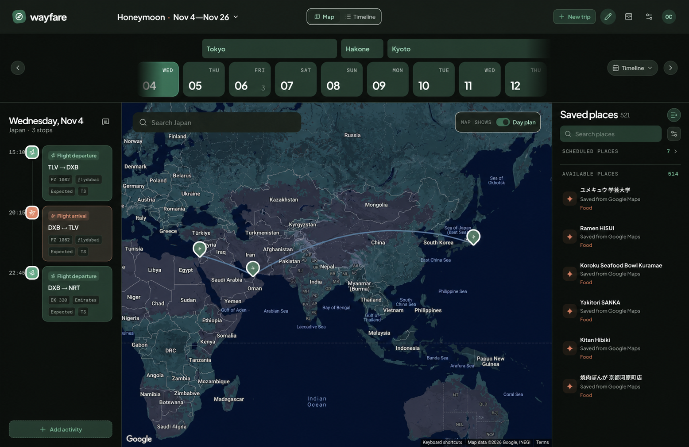
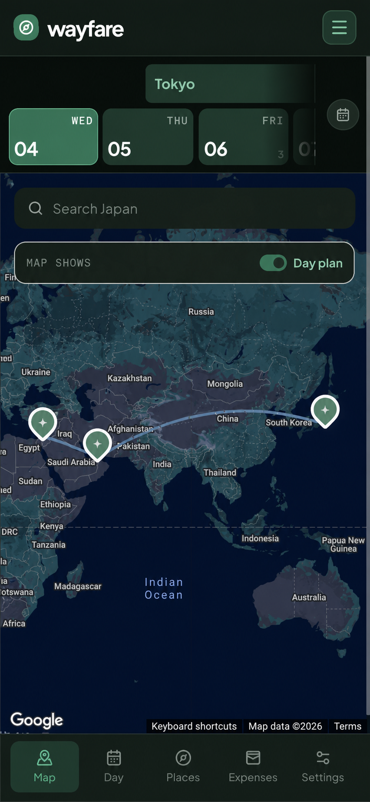

# Wayfare

Wayfare is a map-first planner for independent trips. Keep the places, days, stays, flights, and shared expenses that matter together in one calm workspace.

## Screenshots

These are real captures of the authenticated trip workspace, shown at desktop and mobile breakpoints.

<p align="center">
  
</p>

<p align="center">
  
</p>

## What it includes

- A trip editor with date navigation and a visual itinerary
- A reusable saved-place library and scheduling for each trip day
- Stays, flights, and shared expenses alongside the plan
- Google Maps and Places search integration
- Email/password and Google sign-in through Supabase
- An iPhone-first Expo app with native map, tabs, sheets, haptics, secure session storage, and cached online-first reads
- Shareable Editor/Viewer invitations with owner-controlled membership

## Workspace layout

- `apps/web` — the existing Next.js application and protected server integrations
- `apps/mobile` — the Expo Router iOS app
- `packages/domain` — shared validation and trip contracts
- `supabase/migrations` — the RLS-backed data model, including invitations

## Run locally

```bash
volta install node@22
corepack enable
# If you use Volta: volta install pnpm@12.3.4
pnpm install
cp .env.example .env.local
pnpm run dev:web
```

Then open [http://localhost:3000](http://localhost:3000).

For the native app, copy [`apps/mobile/.env.example`](apps/mobile/.env.example) to `apps/mobile/.env`, add only its public values, then run:

```bash
pnpm run dev:mobile
```

Start in Expo Go for auth and planner flows. The native Google map and Google OAuth redirect require an iOS development build:

```bash
cd apps/mobile
npm exec --yes --package=eas-cli@latest -- eas build --profile development --platform ios
```

`EXPO_PUBLIC_GOOGLE_MAPS_IOS_KEY` must be a platform-restricted iOS key; it is distinct from the web Maps JavaScript key. Server-only Google Places and AeroDataBox keys remain in the web app environment.

## Supabase setup

Create a Supabase project, copy its Project URL and Publishable key into the repository `.env.local` using `NEXT_PUBLIC_SUPABASE_URL` and `NEXT_PUBLIC_SUPABASE_PUBLISHABLE_KEY`, then apply every migration in `supabase/migrations` in timestamp order. The workspace-aware Next config continues to load this repository-level file. The migrations create the trip foundation, RLS policies, and shareable invitation functions. Open `/login` or `/signup` to test email/password auth.

To enable Google sign-in, enable Google under Supabase Dashboard → Authentication → Providers, add the Supabase callback URL shown there to Google Cloud Console, and add these app callback URLs under Authentication → URL Configuration:

```text
http://localhost:3000/auth/callback
https://your-production-domain.com/auth/callback
wayfare://auth/callback
```

For email confirmation with SSR cookies, set the Supabase Confirm signup email template to use `{{ .SiteURL }}/auth/confirm?token_hash={{ .TokenHash }}&type=email`.

The live map uses two Google Maps Platform credentials: `NEXT_PUBLIC_GOOGLE_MAPS_API_KEY` is a browser-restricted Maps JavaScript key, and `GOOGLE_MAPS_SERVER_API_KEY` is a server-only key used by `/api/places` for Places API (New) Text Search. Enable Maps JavaScript API, Places API (New), and billing in Google Cloud. Set `NEXT_PUBLIC_GOOGLE_MAPS_MAP_ID` to a map ID so Advanced Markers can render.

Flight search uses AeroDataBox through RapidAPI. Add the RapidAPI key to `.env.local` as `AERODATABOX_API_KEY`; `AERODATABOX_API_HOST=aerodatabox.p.rapidapi.com` is optional because it is the default. Keep both variables server-only. Protected web routes accept the browser cookie session or a mobile Supabase bearer token, so the app never receives server credentials.

## Verification

```bash
pnpm release:check
```

The shared test suite covers date validation, currency-separated totals, query behavior, and bearer token parsing. Validate authentication/deep links, RLS permissions, viewer/editor roles, Google Places, and flight lookup on an iPhone before publishing an internal EAS build. Cached data remains visible while offline, but edits require reconnection.

## Current domain model

`SavedPlace` is the reusable library record. `ScheduleItem` is a dated occurrence of that saved place. A place can therefore be scheduled more than once without duplicating its library record.
